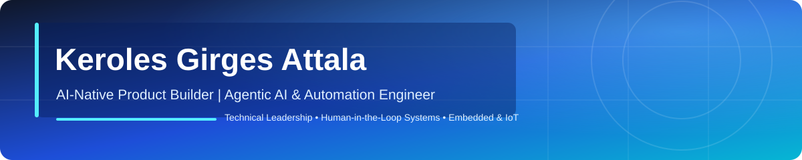

## About me

I am a **Technical Content Team Leader and engineering lead** based in Cairo, Egypt. I lead multidisciplinary teams that design, review, and deliver programming education and real-world software projects for learners and organizations across the MENA region.

My work sits at the intersection of **engineering, technical education, backend development, embedded systems, and AI-powered productivity**. I enjoy turning complex technical requirements into clear systems, reliable workflows, and practical learning experiences.

- Leading a team of **20-30 developers**, including senior technical leads
- Leading the **Web Development Track for the Digital Egypt Cubs Initiative (DECI)** with MCIT
- Building internal tools and AI workflows that improve production quality and team efficiency
- Former Samsung Electronics equipment engineer, focused on robotics and automated production lines

## What I build

<table>
<tr>
<td width="50%" valign="top">

### AI and software systems

I build practical tools, APIs, backend services, and multi-agent workflows that help teams automate repetitive work and ship better outcomes.

**Focus:** Python, Node.js, APIs, databases, automation, Docker, JavaScript

</td>
<td width="50%" valign="top">

### Embedded and connected systems

I design and review firmware and connected systems across microcontrollers, sensors, communication protocols, and real-time environments.

**Focus:** C/C++, STM32, AVR, ESP8266, RTOS, UART, SPI, I2C, CAN, LIN

</td>
</tr>
</table>

## Featured work

| Project | What it demonstrates |
| --- | --- |
| [ContentOS Multi-Agent Platform](https://github.com/kerolesgirges/contentos-multi-agent-platform) | Multi-agent content workflow orchestration with a production-minded architecture |
| [ESP32 Voice Assistant](https://github.com/kerolesgirges/Voice-Assistant-5) | ESP32-S3 push-to-talk assistant using the OpenAI Realtime API |
| [Vehicle Tracking System](https://github.com/kerolesgirges/vts) | Embedded systems, sensors, communication, and real-time control concepts |
| [Embedded Engineering Roadmap](https://github.com/kerolesgirges/Embedded-Engineering-Roadmap) | A practical learning path for embedded systems engineers |
| [Awesome LLM Apps](https://github.com/kerolesgirges/awesome-llm-apps) | Curated examples of LLM applications, agents, and retrieval-augmented generation |

## Technical toolkit

<strong>More areas I work across</strong>

**Software engineering:** OOP, data structures and algorithms, API design, backend development, system design, databases

**Embedded systems:** AVR, ARM, STM32, RTOS, AUTOSAR fundamentals, MCAL/HAL drivers, functional safety, embedded cybersecurity

**Protocols and peripherals:** UART, SPI, I2C, CAN, LIN, GPIO, ADC, timers, EEPROM, watchdog timers

**Quality engineering:** requirements review, test scenarios, test cases, bug reports, API testing, Postman, Newman, Jenkins, JMeter, Scrum, Kanban, SDLC, STLC

## GitHub at a glance

## Experience snapshot

- **Technical Content Team Leader - ISCHOOL** · Nov 2024 - Present
- **Mentor - ISCHOOL** · May 2024 - Oct 2024
- **Programming Instructor - ISCHOOL** · Nov 2023 - May 2024
- **Equipment Engineer - Samsung Electronics Egypt** · Nov 2021 - Dec 2022
- **B.Eng. Electronics and Communication - Fayoum University** · 2016 - 2021

## Let’s connect

I am open to conversations about engineering leadership, technical education, embedded systems, backend development, AI workflows, and building tools that make teams more effective.

**[LinkedIn](https://www.linkedin.com/in/keroles-girges-717b61113/)** · **[Email me](mailto:keroloesgirges@gmail.com)** · **[Explore my repositories](https://github.com/kerolesgirges?tab=repositories)**

