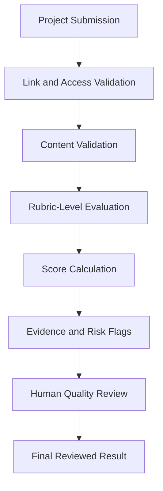

<div align="center">


<a href="https://github.com/kerolesgirges"></a>
<a href="https://www.linkedin.com/in/keroles-girges/"></a>
<a href="mailto:keroloesgirges@gmail.com"></a>

</div>

# Hi, I'm Keroles Girges

### AI-Native Product Builder · Systems Thinker · Technical Team Leader

I build at the intersection of **AI, software, people, and operations**.

My work is not limited to writing code, producing content, or managing teams. I study how work actually happens: where decisions slow down, where quality becomes inconsistent, where people repeat the same task, and where important knowledge remains trapped inside documents or individual experience. Then I turn that understanding into a system.

Sometimes that system is an AI agent. Sometimes it is an internal tool, a workflow, a dashboard, an evaluation pipeline, or a new operating model for a team. The technology changes. The goal does not:

> **Turn complicated human work into a clear, reliable, and scalable system—without removing human judgment from the decisions that matter.**

I started as an electronics and embedded-systems engineer, worked inside a Samsung mobile factory, moved into programming education, became a mentor, and now lead technical content and AI-enabled initiatives at iSchool. That path taught me to think across layers: hardware and software, users and systems, delivery and quality, ideas and execution.

I am now focused on building **AI-native products, agentic workflows, internal tools, and intelligent operational systems**—especially the kind that must work with real users, real constraints, and real accountability.

---

## The Short Version

```text
I do not begin with a model.
I begin with the work.

What decision is being made?
What information does it require?
Where can the process fail?
What should AI handle?
What must a human approve?
How will we know the system is right?
```

That is how I approach both engineering and leadership.

---

## What I Do

- Translate ambiguous operational problems into structured product and system requirements.
- Build AI-assisted workflows, agents, internal tools, dashboards, and prototypes.
- Design human-in-the-loop systems where AI accelerates judgment instead of pretending to replace it.
- Connect technical implementation with real business and user needs.
- Lead multidisciplinary teams through planning, production, QA, review cycles, and delivery.
- Turn repeated work into reusable processes, standards, and automation.
- Explain technical systems clearly to engineers, educators, managers, and non-technical stakeholders.
- Use evidence, testing, and feedback loops to improve both products and teams.

---

## My Professional Story

### From engineering machines to engineering systems

My foundation is in **Electronics and Communication Engineering**. I graduated from Fayoum University ranked **6th** in my class. My graduation project—an IoT home automation and security platform—received **98%**. It combined C, Python, ESP8266, Raspberry Pi, sensors, a local server, and an Android application to manage home control, security, plant irrigation, and power monitoring.

At **Samsung Electronics Egypt**, I worked as an Equipment Engineer in the mobile factory. I maintained and improved embedded hardware and software, modified production lines, enhanced robotics and machine-safety systems, and solved problems where reliability mattered more than presentation.

That environment shaped my engineering instincts: understand the full system, find the real failure point, and build for operation—not only for demonstration.

### From teaching code to designing learning systems

I later moved into technical education at **iSchool**, first as a Programming Instructor, then as a Mentor, and now as a Content Team Leader.

I have worked across programming education, web development, backend engineering, DevOps and cloud concepts, K–12 curricula, tutor development, assessment systems, and technical-content production for learners aged **6–18**.

My work includes major programs such as:

- **Digital Egypt Cubs Initiative / Digital Egypt Marvels Initiative (DECI/DEMI)**
- Web Development Levels 3–5: Frontend, Backend, DevOps, and Cloud
- K–12 technical curricula
- Tutor Academy and AI-for-Tutors programs
- Applied AI professional training
- Rubric-based assessment and grading workflows
- Production, review, quality, and publishing systems

This work taught me something important: education at scale is not only a content problem. It is a systems problem involving people, workflows, standards, feedback, data, tools, and decisions.

That realization moved me toward the work I want to spend the next stage of my career doing: **building AI-powered systems that improve how organizations think and operate**.

---

## What I Am Building and Exploring

### 1. AI-Assisted Project Grading System

I am designing a rubric-driven grading workflow that evaluates student project submissions while keeping consequential decisions under human control.

The system is structured around:



The design principles matter as much as the implementation:

- Evaluate at the task and rubric-criterion level.
- Preserve evidence for every judgment.
- Separate possible AI-use indicators from academic scoring.
- Never infer authorship from weak signals.
- Never allow the agent to make an unsupported Pass/Fail decision.
- Require human review before a consequential grade change.
- Calibrate the system using real reviewer feedback and error analysis.

This is the kind of AI system I believe in: useful, inspectable, careful about uncertainty, and designed around responsibility.

### 2. AI-Powered Quality and Content Operations

I work on the design of AI-enabled processes for technical-content production and quality assurance. These processes explore combinations of:

- Video and frame analysis
- Transcription auditing
- RAG over standards, scripts, and reference material
- Agent prompts for specialized review tasks
- Structured QA outputs
- Human verification and correction loops
- Dashboards for progress, capacity, blockers, and delivery status

The goal is not to add AI to every step. The goal is to identify where AI can reduce repetitive effort, reveal missed issues, and give people better information for making decisions.

### 3. Operational Dashboards and Workflow Systems

I have designed and managed spreadsheet-based operational systems for:

- Team capacity and allocation
- Content-production progress
- Video-production and rework tracking
- Delivery blockers and dependencies
- Grading operations
- Review cycles, reminders, approvals, and publishing status

I care about preserving data integrity—not only creating a visually attractive dashboard. In one workflow, for example, I normalized inconsistent names across **412 submissions** while preserving every row and its original order so the data remained safe for filtering and analysis.

### 4. Applied AI Training and Enablement

I helped shape and deliver an Applied AI Professional Bootcamp covering practical AI use across:

- Prompt engineering
- Productivity and structured workflows
- Data analysis and market intelligence
- Marketing and media automation
- AI-assisted software development
- Web design and rapid prototyping
- AI cloning and reusable systems
- Capstone delivery

My focus is not teaching people a collection of prompts. It is helping them map the problem, structure the workflow, choose what the model should and should not do, protect data, verify the result, and produce something useful.

### 5. Rapid AI-Native Prototyping

I use tools such as Claude Code and Codex to move quickly from a problem to a working prototype. One example was a voice-enabled mathematics quiz built in under an hour to explore multimodal, voice, and visual interaction.

Speed matters, but only when paired with judgment. My preferred loop is:

> **Think → Direct → Build → Verify**

AI can accelerate every stage, but responsibility for the final system remains human.

---

## Selected Earlier Engineering Work

Before focusing on AI-native products, I built systems across embedded software, IoT, backend development, and automation:

- **IoT Home Automation and Security System** — C, Python, ESP8266, Raspberry Pi, sensors, local server, and Android control.
- **Vehicle Tracking System** — STM32, GPS, SIM communication, remote data transmission, and a PHP administration panel for live monitoring.
- **Cruise Control System** — ATmega32 drivers, ultrasonic sensing, Bluetooth control, LCD, relay, EEPROM, timers, UART, ADC, and an Android controller.
- **WhatsApp Sender Desktop Tool** — Python/Tkinter automation with link parsing, phone-number extraction, threading, browser control, error handling, and a responsive GUI.
- Additional work in factory monitoring, solar tracking, a payment application, a stack-based calculator, a 4-bit microprocessor, and traffic-violation reporting.

These projects gave me a broad technical foundation. More importantly, they taught me to connect components into complete systems.

---

## How I Think

### 1. Start with the real problem

I do not treat the first request as the final requirement. I look for the process behind it, the people affected by it, the decision it supports, and the reason the current approach fails.

### 2. Design the workflow before choosing the tool

AI, automation, dashboards, APIs, and agents are implementation choices. A good system begins with a clear model of inputs, decisions, states, exceptions, owners, and outputs.

### 3. Make judgment visible

If a system produces a score, recommendation, flag, or decision, I want to know why. Evidence, traceability, review states, and error handling are product features—not afterthoughts.

### 4. Keep humans where accountability lives

I am excited by autonomous agents, but I do not confuse autonomy with correctness. High-impact decisions need clear boundaries, escalation paths, and human approval.

### 5. Build for the failure path

The happy path is a demo. The failure path is the product. I think about missing data, inaccessible links, inconsistent formats, ambiguous instructions, model uncertainty, retries, fallbacks, and recovery.

### 6. Turn individual excellence into a repeatable system

A strong team should not depend on one person remembering everything. I build templates, standards, documentation, dashboards, review loops, and shared ways of working so quality can scale.

### 7. Measure what matters, then improve it

I prefer evidence over assumptions. I track delivery, quality, review cycles, rework, blockers, and outcomes, then use the data to improve the process—not to decorate a report.

---

## My Leadership Philosophy

I want to help people move from **executors** to **system builders**.

For me, leadership is not task distribution. It is creating enough clarity, ownership, and feedback that people understand the purpose of the work and can improve the system themselves.

In practice, that means:

- Define quality clearly before reviewing the output.
- Give context, not only instructions.
- Build feedback loops that reduce repeated mistakes.
- Separate a person from a process failure.
- Make ownership visible.
- Document decisions and dependencies.
- Escalate with evidence.
- Protect the team from avoidable ambiguity.
- Teach people how to think, not only what to deliver.

I have led technical-content developers and senior technical leads across B2G, B2B, and B2C programs, coordinated complex review and approval cycles with external stakeholders, supported tutor performance and development, and helped transform large programs from collections of deliverables into managed production systems.

I also contributed to curriculum work that received **ISTE Seal** recognition—an experience that reinforced my belief that innovation and quality must be made visible through standards and evidence.

---

## Technical Toolbox

I treat tools as building blocks, not as an identity. These are the areas I work with or am actively deepening:

| Area | Technologies and Practices |
|---|---|
| **AI and Agentic Systems** | LLM APIs, prompt and context design, RAG, embeddings, vector search concepts, tool calling, structured outputs, agent workflows, MCP concepts, human-in-the-loop design, evaluation and guardrails |
| **AI-Native Development** | Claude Code, Codex, rapid prototyping, specification-driven building, AI-assisted research, code generation with human verification |
| **Software Development** | Python, JavaScript, Node.js, Java, C, C++, REST APIs, backend design, OOP, data structures, algorithms |
| **Web and Data** | Express, MongoDB/Mongoose, HTML/CSS, SQL concepts, Postman, data transformation, Google Sheets automation and dashboards |
| **Quality Engineering** | Test scenarios and cases, bug reporting, API testing, Newman, Jenkins, JMeter, requirements analysis, SDLC, STLC, ISTQB-aligned practices |
| **DevOps and Delivery** | Git/GitHub, GitFlow concepts, Docker fundamentals, CI/CD concepts, Azure DevOps, Jira, Trello, Scrum, Kanban |
| **Embedded and IoT** | AVR, STM32, ESP8266, Raspberry Pi, Embedded C, RTOS, AUTOSAR fundamentals, MCAL/HAL, UART, SPI, I2C, CAN, LIN, sensors and control systems |
| **Product and Operations** | Workflow mapping, requirements discovery, process design, stakeholder communication, technical documentation, metrics, review systems, capacity and delivery planning |

I am currently investing most deeply in **Python backend engineering, agent orchestration, RAG evaluation, observability, deployment, and production-grade AI system design**.

---

## The Public Portfolio I Am Building

My GitHub is becoming a laboratory for practical AI software—not a collection of disconnected tutorials.

The projects I am developing will focus on:

1. **Rubric-Aware Project Evaluation Agent**  
   Evidence-grounded grading, task-level scoring, risk flags, and human approval.

2. **AI Content Quality Auditor**  
   Multi-stage review across scripts, transcripts, video evidence, standards, and structured QA reports.

3. **Agentic Operations Workspace**  
   A system that converts requests into planned, assigned, monitored, and reviewable workflows.

4. **Session Intelligence and Behavior Analysis**  
   Tools for turning live-session data into useful signals while preserving clear human interpretation and responsible boundaries.

5. **AI-Native Knowledge and Production System**  
   RAG, tool use, reusable organizational knowledge, controlled generation, validation, and publishing workflows.

Each repository will aim to show more than code. It will document:

- The real problem
- The users and operating context
- The architecture and trade-offs
- The workflow and failure paths
- Evaluation and quality controls
- Security and privacy considerations
- What did not work
- What I would improve next

That is the engineering story I want my work to tell.

---

## What I Want to Build Next

I want to work with a team that sees AI as a new software and product layer—not as a chatbot added at the end.

I am especially interested in roles such as:

- **AI Full-Stack Engineer**
- **Agentic AI Engineer**
- **Forward Deployed Engineer**
- **AI Automation Engineer**
- **Applied AI / Solutions Engineer**
- **AI-Native Product Engineer**

The best environment for me is one where I can:

- Work closely with users and stakeholders.
- Understand an important operational problem.
- Prototype quickly.
- Build the backend, workflow, agent, and interface needed to solve it.
- Test the system with real evidence.
- Deploy, observe, and improve it.
- Help the organization change how the work is done.

I am based in **Cairo, Egypt**, open to strong local opportunities, remote roles, and relocation for the right mission.

---

## A Few Things I Believe

> **AI should increase the quality of human judgment, not hide the absence of it.**

> **The best automation removes repetition while preserving responsibility.**

> **A prototype proves possibility. A product proves reliability. A system proves that value can continue without its creator standing beside it.**

> **Good engineering starts when we stop asking only “Can we build it?” and begin asking “How will it behave when reality is messy?”**

> **My goal is not to become a person who uses every AI tool. My goal is to become a person who can build what did not exist before.**

---

## Let’s Connect

I am always interested in conversations about agentic systems, AI-enabled operations, education technology, internal tools, product engineering, and difficult workflows worth redesigning.

- **LinkedIn:** [linkedin.com/in/keroles-girges](https://linkedin.com/in/keroles-girges/)
- **GitHub:** [github.com/kerolesgirges](https://github.com/kerolesgirges)
- **Email:** [keroloesgirges@gmail.com](mailto:keroloesgirges@gmail.com)
- **Location:** Cairo, Egypt

---

<p align="center">
  <strong>I am not trying to fit AI into an old title.</strong><br/>
  I am building the combination of engineering, product thinking, leadership, and human judgment needed for what comes next.
</p>
